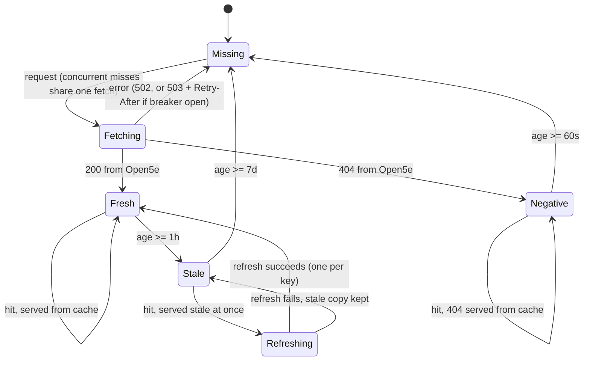

# Tavernkeep

A fast, outage-proof D&D 5e SRD lookup API in Rust, backed by [Open5e](https://open5e.com).

When the wizard casts Fireball and nobody remembers the save DC, the table shouldn't stall because the venue Wi-Fi dropped or Open5e is having a bad night. Tavernkeep looks up spells and monsters, caches them aggressively (it keeps serving week-old copies while upstream is down), and rolls real dice notation, including monster attacks with critical hits. Warm it with your party's spell list before the session and it works offline.

## Quickstart

```sh
make demo
```

This builds a release binary and runs `scripts/demo.sh` against the real Open5e API. The demo looks up Fireball and a Goblin, rolls `adv+3` and a goblin attack, then restarts Tavernkeep pointed at a dead upstream. Cached lookups keep working, and the circuit breaker opens in `/metrics`. It needs `curl` and `python3`.

To run the service:

```sh
cargo run --release                       # listens on 0.0.0.0:8080
docker compose up --build                 # tavernkeep behind NGINX on :8080
tavernkeep warm --file party.example.txt  # prefetch before game night
```

| Make target | What it does |
|---|---|
| `make check` | `cargo fmt --check`, `cargo clippy --all-targets -- -D warnings`, `cargo test` (no network) |
| `make test` | `cargo test` |
| `make demo` | End-to-end demo against Open5e |
| `make load` | Warm-cache load test (`oha` if installed, else `src/bin/loadgen.rs`) |

## Endpoints

| Method and path | Description |
|---|---|
| `GET /spells/{slug}` | Spell, with `ETag`, `If-None-Match` → 304, and `Cache-Control` |
| `GET /monsters/{slug}` | Monster, same caching headers |
| `GET /search?q=&kind=spell\|monster` | Proxies Open5e search; `q` is 2–64 characters; cached 5 minutes |
| `POST /roll` | Roll dice notation, optionally seeded |
| `GET /monsters/{slug}/attack/{action_index}` | Roll to-hit and damage for a monster action (`?seed=` optional) |
| `GET /healthz` | Liveness |
| `GET /readyz` | Ready if Open5e answered in the last 60s or the cache has entries |
| `GET /metrics` | Prometheus metrics |

Errors are JSON: `{"error": "<code>", "message": "...", "position"?: n}`.

### Example requests and responses

All of these were captured from a running instance against Open5e.

```sh
$ curl -i localhost:8080/spells/fireball
HTTP/1.1 200 OK
content-type: application/json
etag: "aceb0d221da14bef"
cache-control: public, max-age=3599

{"slug":"fireball","name":"Fireball","level":3,"school":"Evocation","casting_time":"1 action",
 "range":"150 feet","duration":"Instantaneous","components":"V, S, M","concentration":false,
 "ritual":false,"description":"A bright streak flashes from your pointing finger to a point you choose ..."}

$ curl -s -o /dev/null -w '%{http_code}\n' -H 'If-None-Match: "aceb0d221da14bef"' localhost:8080/spells/fireball
304
```

```sh
$ curl -s 'localhost:8080/search?q=fireb&kind=spell'
{"kind":"spell","query":"fireb","count":6,"results":[{"slug":"antimagic-field","name":"Antimagic Field"},
 {"slug":"delayed-blast-fireball","name":"Delayed Blast Fireball"},
 {"slug":"delayed-blast-fireball-a5e","name":"Delayed Blast Fireball"},{"slug":"fireball","name":"Fireball"},
 {"slug":"fireball-a5e","name":"Fireball"},{"slug":"sanctuary","name":"Sanctuary"}]}
```

```sh
$ curl -s -X POST localhost:8080/roll -H 'content-type: application/json' -d '{"expr":"4d6kh3+2","seed":42}'
{"expr":"4d6kh3+2","total":12,"rolls":[{"die":"4d6kh3","results":[1,4,2,4],"kept":[4,2,4]}],"modifier":2}

$ curl -s -X POST localhost:8080/roll -H 'content-type: application/json' -d '{"expr":"2d20kh1+101d6"}'
{"error":"unprocessable","message":"dice count must be between 1 and 100 at position 8","position":8}
```

```sh
$ curl -s 'localhost:8080/monsters/goblin/attack/0?seed=7'
{"monster":"goblin","action":"Scimitar","to_hit":{"natural":9,"bonus":4,"total":13},"critical":false,
 "damage":{"expr":"1d6+2","total":3,"rolls":[{"die":"1d6","results":[1],"kept":[1]}],"modifier":2}}
```

On a natural 20 the damage dice are doubled but the flat bonus is not (`1d6+2` becomes `2d6+2`). Actions with no attack bonus, such as Multiattack, return 422.

## Dice grammar

The parser is hand-written (`src/dice/parser.rs`). Whitespace between tokens is allowed and input is case-insensitive.

```text
expr   := sign? term (op term)*
op     := '+' | '-'
term   := 'adv' | 'dis' | dice | int
dice   := int? 'd' int select?
select := ('kh' | 'kl' | 'dh' | 'dl') int?
```

| Notation | Meaning |
|---|---|
| `NdM` | Roll N dice with M sides; `d20` means `1d20` |
| `4d6kh3` / `2d20kl1` | Keep the highest / lowest K (`kh` alone means `kh1`) |
| `4d6dl1` / `3d8dh1` | Drop the lowest / highest K |
| `1d8+2d6-1` | Add or subtract integers and other dice terms |
| `adv` / `dis` | Shortcuts for `2d20kh1` / `2d20kl1` |

Limits: N ≤ 100, M in 2..=1000, at most 10 terms. Keep needs 1..=N and drop needs 1..N−1. Anything over a limit, or any syntax error, returns **422** with the 0-based `position` of the offending character. The same `seed` always gives the same result.

## How the cache works

Every spell and monster lookup goes through a stale-while-revalidate cache (moka). Ages come from an injectable clock, so the tests can drive every transition.



Upstream calls have a 3s timeout and up to 3 attempts. Retries use exponential backoff with full jitter and happen only on 5xx, timeouts and connection errors. A circuit breaker opens after 5 consecutive failed calls, stays open for 30s, then lets a single probe through. While it's open, stale copies are served, and anything uncached gets `503` with `Retry-After`.

If `TK_CACHE_FILE` is set, cached spells and monsters are saved to that file every minute and on graceful shutdown, and loaded on startup with their ages intact. A restarted instance therefore keeps serving the table while Open5e is unreachable. Docker Compose stores the file on a named volume.

## Reliability guarantees

| Guarantee | Proven by |
|---|---|
| A slug that has been cached never returns 5xx while its stale copy exists (10 warmed slugs, upstream returns 500, 2,000 requests: 0 responses ≥ 500, breaker opens, then recovers) | `tests/reliability.rs::outage_never_returns_5xx_for_cached_slugs_and_recovers` |
| Concurrent misses for one key make exactly one upstream call (200 concurrent cold requests → 1 call) | `tests/reliability.rs::coalescing_200_concurrent_cold_requests_make_one_upstream_call`, `src/cache.rs::concurrent_misses_share_one_fetch` |
| A never-cached slug during an outage gets 503 with `Retry-After` | `tests/reliability.rs::never_cached_slug_during_outage_gets_503_with_retry_after` |
| Stale entries are served immediately, with at most one background refresh per key; a failed refresh keeps the stale copy | `src/cache.rs::stale_is_served_then_refreshed_in_background`, `at_most_one_refresh_per_key`, `failed_refresh_keeps_the_stale_copy` |
| Upstream 404s are cached for 60s | `tests/reliability.rs::upstream_404_is_cached_for_60_seconds`, `src/cache.rs::not_found_is_cached_for_the_negative_ttl` |
| `ETag` / `If-None-Match` → 304 | `tests/reliability.rs::etag_and_if_none_match_return_304` |
| Retries only on 5xx, timeouts and connection errors (including connections dropped mid-body) | `tests/reliability.rs::retries_5xx_then_succeeds`, `client_errors_are_not_retried`, `timeouts_are_retried`, `src/open5e/client.rs` tests |
| Breaker: opens after 5 failures, 30s cooldown, single half-open probe | `src/breaker.rs` tests (injected clock) |
| Backoff stays under the exponential ceiling with full jitter | `src/backoff.rs` tests |
| Cached data survives a restart against a dead upstream | `tests/snapshot.rs::restart_against_dead_upstream_serves_snapshotted_entries` |
| Warmed slugs work offline | `tests/warm.rs::warm_prefetches_so_lookups_survive_an_outage` |
| Dice totals stay within the expression's bounds, kept count = N − dropped, same seed → same output, random input never panics | `tests/dice_props.rs` (proptest), `src/dice/eval.rs::golden_seeded_roll` |
| Attack rolls are reproducible with a fixed seed, and a natural 20 doubles the damage dice | `tests/attack.rs` |

## Load numbers

The numbers below come from `make load`. It serves the recorded fixtures from a local static server (no network), warms the cache, and hammers one warm-cache endpoint.

- **Machine:** Apple M2 Max, 12 cores, 96 GiB RAM, macOS (Darwin 25.6.0, arm64)
- **Command:** `make load`, which runs `oha --no-tui -z 15s -c 64 http://127.0.0.1:18901/monsters/adult-red-dragon` (oha 1.17.0, release build, 1.79 KiB response)

| Requests | Success | Requests/sec | p50 | p95 | p99 |
|---|---|---|---|---|---|
| 2,088,250 | 100% | 139,190 | 0.461 ms | 0.557 ms | 0.629 ms |

The load generator ran on the same machine as the server, so the numbers include its CPU contention.

## Configuration

All settings come from environment variables, validated at startup. An invalid value exits with code 2 and names the variable.

| Variable | Default |
|---|---|
| `TK_BIND` | `0.0.0.0:8080` |
| `TK_UPSTREAM_URL` | `https://api.open5e.com/v1` |
| `TK_UPSTREAM_TIMEOUT_MS` | `3000` |
| `TK_UPSTREAM_ATTEMPTS` | `3` |
| `TK_BACKOFF_BASE_MS` / `TK_BACKOFF_MAX_MS` | `100` / `2000` |
| `TK_FRESH_TTL_SECS` / `TK_STALE_TTL_SECS` | `3600` / `604800` |
| `TK_NEGATIVE_TTL_SECS` | `60` |
| `TK_SEARCH_TTL_SECS` | `300` |
| `TK_CACHE_CAPACITY` | `10000` entries per cache |
| `TK_BREAKER_THRESHOLD` / `TK_BREAKER_COOLDOWN_SECS` | `5` / `30` |
| `TK_READY_WINDOW_SECS` | `60` |
| `TK_CACHE_FILE` | unset (no snapshot); must be writable, checked at startup |
| `TK_LOG` | `info` (`tracing` env-filter syntax; JSON logs) |
| `TK_WARM_URL` | `http://127.0.0.1:8080` (for `warm`) |

SIGTERM triggers a graceful shutdown: in-flight requests drain and the snapshot is saved.

Metrics: `tk_requests_total{route,status}`, `tk_cache_events_total{result}`, `tk_upstream_requests_total{outcome}`, `tk_upstream_duration_seconds`, `tk_breaker_open`, `tk_rolls_total`.

## Open5e credit and license

Game data comes from the [Open5e API](https://open5e.com), a community project that serves 5e content under open licenses. Thank you to the Open5e maintainers and contributors.

The license shown below was read from Open5e's documents endpoint (`GET https://api.open5e.com/v1/documents/?slug=wotc-srd`) on 2026-11-26. It isn't a guess.

- **Document:** 5e Core Rules (System Reference Document 5.1), Wizards of the Coast
- **License:** Open Gaming License (license URL as reported: http://open5e.com/legal)
- **Copyright:** System Reference Document 5.1 Copyright 2016, Wizards of the Coast, Inc.; Authors Mike Mearls, Jeremy Crawford, Chris Perkins, Rodney Thompson, Peter Lee, James Wyatt, Robert J. Schwalb, Bruce R. Cordell, Chris Sims, and Steve Townshend, based on original material by E. Gary Gygax and Dave Arneson.

Search results can include other Open5e documents. Each one carries its own license, which the documents endpoint reports. Most are under the Open Gaming License, and Level Up Advanced 5e (`a5e`) is under CC BY 4.0. Tavernkeep stores no game content in this repository except the recorded test fixtures in `tests/fixtures/`.

Tavernkeep's own code is MIT licensed (see `LICENSE`).

## Next steps

- An initiative tracker for the table
- A shared Redis cache so several instances share one warm cache
- A WebSocket roll feed so everyone sees rolls live
